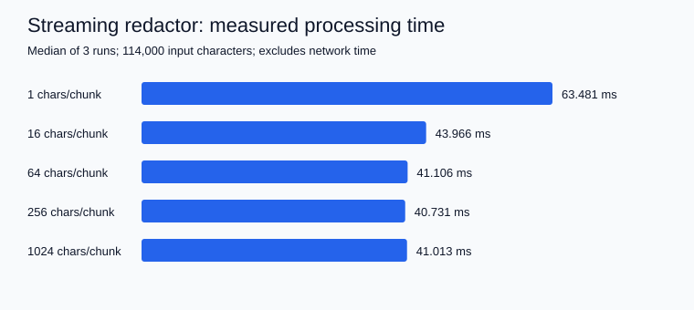

# Quilr AI Field Developer Assessment

Four Python services demonstrating MCP tools, tool-level authorization, streamed PII redaction, and a persistent token quota with model failover. Customer records, refunds, credentials, and LLM responses are **simulated**. No paid API key is needed.

[](https://github.com/vedhireanvesh29-eng/Quilr_ai_Assessment/actions/workflows/ci.yml)

## Quick start

Requires Python 3.11+ and [uv](https://docs.astral.sh/uv/).

```sh
git clone https://github.com/vedhireanvesh29-eng/Quilr_ai_Assessment.git
cd Quilr_ai_Assessment
uv sync --locked
uv run python scripts/run_demo.py
```

The launcher starts five localhost processes. Run the stdio MCP server separately with `uv run assessment-mcp`; it waits for protocol input and does not expose an HTTP port.

| Component | Command | Address |
|---|---|---|
| Task 1: MCP tools | `uv run assessment-mcp` | stdio |
| Task 2: security gateway | `uv run uvicorn ai_field_assessment.task2_mcp_gateway.app:app --port 8000` | `POST /mcp` |
| Mock downstream MCP | `uv run uvicorn ai_field_assessment.task2_mcp_gateway.mock_mcp_server:app --port 8001` | `POST /mcp` |
| Mock LLM providers | `uv run uvicorn ai_field_assessment.task3_stream_guardrail.mock_llm_provider:app --port 8002` | `/generate`, `/primary`, `/backup` |
| Task 3: streaming guardrail | `uv run uvicorn ai_field_assessment.task3_stream_guardrail.app:app --port 8003` | `POST /generate` |
| Task 4: model router | `uv run uvicorn ai_field_assessment.task4_model_router.app:app --port 8004` | `POST /completions` |

FastAPI documentation is available at `/docs` on each HTTP service. Bind to localhost for these development demonstrations.

## Project layout

```text
src/ai_field_assessment/
  config.py                 # Immutable environment configuration
  common/jsonrpc.py         # JSON-RPC envelope validation
  task1_mcp_server/          # SDK server, Pydantic schemas, mock customer service
  task2_mcp_gateway/         # Bearer role policy, reverse proxy, mock backend
  task3_stream_guardrail/    # SSE parser, bounded redactor, streaming endpoint, mocks
  task4_model_router/        # SQLite quota, provider adapter, failover, HTTP endpoint
tests/                      # Unit, HTTP integration, cancellation, stdio wire tests
scripts/                    # Demo, verification, offline checks, benchmark
results/                    # Actual local benchmark measurements and plot
.github/workflows/ci.yml     # Clean-environment verification
```

## Task 1: validated MCP tools

`get_customer_record` accepts `{"customer_id":"CUST-12345"}` and returns a simulated active customer. `trigger_refund` accepts:

```json
{"customer_id":"CUST-12345","amount":75.5,"reason":"Product arrived damaged"}
```

Its result includes a `mock-` refund ID, decimal amount string, and `"status":"simulated"`. Customer identifiers require exactly five ASCII digits. Fields are strict, unexpected arguments are refused, and refund amounts must be finite positive numbers. Boolean and string amounts are rejected.

The official MCP SDK v2 owns transport framing, lifecycle, discovery and tool registration. Public middleware maps argument validation to a top-level JSON-RPC `-32602`. Unknown customer business errors use SDK tool errors. See [DESIGN.md](DESIGN.md) for the distinction and version caveats.

Use MCP Inspector with Node.js installed:

```sh
npx @modelcontextprotocol/inspector uv run assessment-mcp
```

Connect with stdio, list the two tools, and call each with the examples above. No authentication is added to Task 1.

## Task 2: authorization proxy

```sh
curl -s http://127.0.0.1:8000/mcp -H 'Authorization: Bearer dev-viewer' -H 'Content-Type: application/json' -d '{"jsonrpc":"2.0","id":5,"method":"tools/call","params":{"name":"admin_reset_key","arguments":{}}}'
```

Expected response, without contacting the backend:

```json
{"jsonrpc":"2.0","id":5,"error":{"code":-32001,"message":"Unauthorized Tool Call"}}
```

Replace the token with `dev-admin` to permit the call. `tools/list` is forwarded transparently, including administrative tools. Roles come exclusively from configured tokens. This is mock authentication, not a production identity system.

The HTTP demonstration accepts one JSON-RPC request per POST. It deliberately rejects batches and notifications; it is not a complete stateful Streamable HTTP MCP implementation. URLs are configured by the server, and incoming headers are not copied to the backend.

## Task 3: streaming redaction

```sh
curl -N http://127.0.0.1:8003/generate -H 'Content-Type: application/json' -d '{"prompt":"Contact john@gmail.com, SSN 123-45-6789, card 4111 1111 1111 1111. Hello!"}'
```

The mock provider echoes the prompt as character deltas, splitting all PII. The gateway emits SSE `data: {"text":"..."}` events followed by `data: [DONE]`. Concatenating text deltas gives redacted output in order. SSE framing can differ from upstream because one safe output segment can span multiple input events.

The redactor buffers candidates until safe delimiters, retains numeric runs across spaces and hyphens, checks cards with Luhn, and replaces detected values with `[REDACTED]`. Oversized candidates fail closed. Errors terminate with a sanitized SSE error event and discard uncommitted text. Cancellation closes the upstream response.

## Task 4: quota and fallback

```sh
curl -s http://127.0.0.1:8004/completions -H 'X-API-Key: demo-tenant' -H 'Content-Type: application/json' -d '{"prompt":"[429] demonstrate fallback","max_output_tokens":64}'
```

The response identifies `"model":"backup"`. A prompt beginning `[timeout]` makes the mock primary exceed the default three-second timeout. `[error]` returns an upstream 500 and does not fall back. Other prompts use the primary.

Quota defaults to 50,000 tokens per tenant over a rolling 60 seconds. Before forwarding, an atomic SQLite transaction reserves UTF-8 input bytes plus maximum output tokens. The byte counter is conservative for the mock and byte-based tokenizers; replace the counter for a provider with different tokenization. Primary success reconciles to reported usage; fallback, failures and cancellations retain the single full reservation. Tenant keys are hashed before storage. Development tenant keys identify tenants without authenticating them.

```json
{"error":{"code":"RATE_LIMIT_EXCEEDED","message":"Unable to process this request","request_id":"generated-id"}}
```

Errors use HTTP 429 for quota, 422 for invalid input, 401 for missing tenant key, 502 for provider failure, 504 when fallback times out, and 503 for database failure.

## Configuration

`.env.example` documents defaults. Export variables in your shell or use Uvicorn's `--env-file .env` with the optional dotenv dependency. The application does not implicitly load `.env` files. CLI `--host` and `--port` control binding. All upstream defaults use localhost.

| Variable | Default |
|---|---|
| `MCP_SERVER_NAME` | `Assessment Customers` |
| `DOWNSTREAM_MCP_URL` | `http://127.0.0.1:8001/mcp` |
| `ADMIN_TOKEN`, `VIEWER_TOKEN` | `dev-admin`, `dev-viewer` |
| `LLM_STREAM_URL` | `http://127.0.0.1:8002/generate` |
| `PRIMARY_PROVIDER_URL`, `BACKUP_PROVIDER_URL` | local mock `/primary`, `/backup` |
| `PRIMARY_TIMEOUT` | `3.0` seconds, also caps backup duration |
| `DATABASE_PATH` | `data/usage.db` |
| `TOKENS_PER_MINUTE` | `50000` |
| `PII_BUFFER_SIZE` | `4096` characters |
| `LOG_LEVEL` | `INFO` |

Real endpoints must implement the documented local contracts or use an adapter. No claim is made that these mock payloads are OpenAI- or Anthropic-compatible.

## Verification

```sh
uv run ruff check .
uv run ruff format --check .
uv run pytest -v
uv run python scripts/verify_all.py
uv run python scripts/benchmark.py
```

Expected behavior: all tests pass; unauthorized calls make zero backend calls; malformed tool arguments produce `-32602`; three simultaneous 20,000-token reservations admit exactly two; timeout cancellation completes before backup starts. Read [results/VERIFICATION.md](results/VERIFICATION.md) for what has actually run in this submission environment.



The plot is generated from measured local runs. This benchmark measures redactor processing and first safe output, excluding network/provider latency. It is not an end-to-end LLM performance claim.

## Limits and next steps

PII detection follows explicit lexical rules, not every possible representation. Conservative candidate buffering can redact long safe tokens, delay a whitespace-free response, or hide incomplete email-like tokens. Retained pending state is bounded; request and HTTP transport buffers have their own limits. Production deployments also need provider-specific tokenization, trusted tenant identity, OIDC authentication, request size limits, TLS, telemetry, and a full MCP HTTP session implementation where applicable.

SQLite is suitable for a local assessment and a shared on-disk database on one host. It is not a cross-region quota service. A provider that suppresses task cancellation can delay timeout completion; adapters must honor cancellation. Refund IDs are simulated and refund records are returned rather than persisted.
