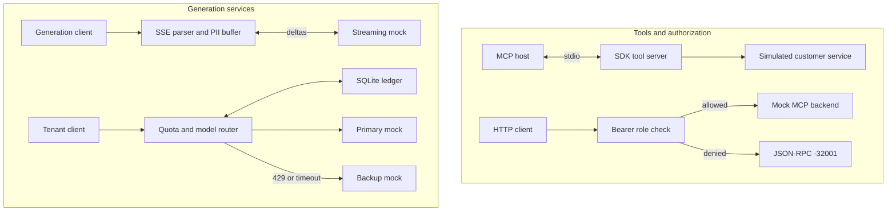

# AI Field Developer Assessment — Python

Four small services demonstrate MCP tools, tool authorization, streaming PII redaction, and model routing with persistent tenant quotas. Customer data, credentials, refunds, and model providers are simulated. No paid API key is needed.

| Task | Behavior |
|---|---|
| MCP server | Discover and call two strictly validated customer tools over stdio |
| Security gateway | Forward JSON-RPC requests and stop unauthorized `admin_` calls |
| Streaming guardrail | Redact emails, SSNs, and Luhn-valid cards across SSE chunk boundaries |
| Model router | Reserve quota in SQLite, call the primary, and use one bounded fallback |

## Architecture

The tasks are independent. Task 2 uses an HTTP mock backend; it does not wrap the Task 1 stdio connection. Task 3 streams responses, while Task 4 returns a single completion.



## Technology stack

| Technology | Purpose |
|---|---|
| Python 3.11+, asyncio | Services, cancellation, and timeouts; CI uses Python 3.12 |
| MCP SDK v2, Pydantic v2 | Tool lifecycle, discovery, and strict validation |
| FastAPI, Uvicorn, HTTPX | HTTP services, SSE, and reusable async clients |
| SQLite | On-disk quota ledger and atomic admission |
| pytest, Ruff | Tests, lint, and formatting |
| Matplotlib 3.10.7 | Optional measured report and PNG figures |

Runtime and test dependencies are resolved in [uv.lock](uv.lock). Plotting is installed separately by the report command.

## Task 1: MCP customer tools

`uv run assessment-mcp` starts an SDK-managed stdio server. It exposes:

- `get_customer_record`: requires an exact `CUST-` identifier followed by five ASCII digits.
- `trigger_refund`: accepts a known customer, finite positive numeric amount, and a reason of at least ten characters. Refunds are simulated and are not persisted.

Example tool call:

```json
{"jsonrpc":"2.0","id":3,"method":"tools/call","params":{"name":"trigger_refund","arguments":{"customer_id":"CUST-12345","amount":75.5,"reason":"Product arrived damaged"}}}
```

The application data includes `"status":"simulated"`, a generated `mock-` refund ID, and a decimal amount string. The SDK wraps this data in MCP tool content. Customer lookup returns:

```json
{"customer_id":"CUST-12345","name":"Demo Customer","status":"active"}
```

Strict schemas reject strings or booleans as amounts and reject extra fields. Malformed JSON receives `-32700`, invalid envelopes `-32600`, unknown methods `-32601`, and invalid tool arguments `-32602`. A valid but unknown customer produces an `isError:true` tool result. Protocol output goes to stdout; logging goes to stderr.

With Node.js installed, inspect the two tools using:

```sh
npx @modelcontextprotocol/inspector uv run assessment-mcp
```

## Task 2: MCP security gateway

The gateway authenticates the configured Bearer token before parsing the request. `dev-admin` permits administrative calls. `dev-viewer` can discover all tools and call ordinary tools, but cannot invoke names beginning `admin_`. Discovery remains unchanged.

```sh
curl -s http://127.0.0.1:8000/mcp -H 'Authorization: Bearer dev-viewer' -H 'Content-Type: application/json' -d '{"jsonrpc":"2.0","id":5,"method":"tools/call","params":{"name":"admin_reset_key","arguments":{}}}'
```

The response is returned before any backend call:

```json
{"jsonrpc":"2.0","id":5,"error":{"code":-32001,"message":"Unauthorized Tool Call"}}
```

Missing or invalid credentials receive HTTP 401. Allowed requests use a fixed server-configured destination; incoming authorization headers are not forwarded. Downstream failures produce sanitized gateway errors. This endpoint supports one JSON-RPC request per POST, without batches, notifications, or MCP HTTP sessions.

## Task 3: streaming PII guardrail

```sh
curl -N http://127.0.0.1:8003/generate -H 'Content-Type: application/json' -d '{"prompt":"Contact john@gmail.com, SSN 123-45-6789, card 4111 1111 1111 1111. Hello!"}'
```

The mock echoes the prompt in small deltas. Concatenating the safe SSE text gives:

```text
Contact [REDACTED], SSN [REDACTED], card [REDACTED]. Hello!
```

The parser incrementally decodes UTF-8 and handles SSE framing. The redactor retains a candidate across chunks, including numeric groups separated by whitespace or hyphens. It checks 13–19 digit cards with Luhn and replaces detected values with `[REDACTED]`. Safe delimited text can leave before the source finishes.

Pending candidate state is capped at 4,096 characters by default. Oversized candidates are redacted and discarded through a safe boundary. A malformed or interrupted upstream stream discards uncertain text and emits a sanitized SSE error. Cancellation closes the upstream response. Direct requests to the mock provider can set `chunk_size` and `truncate_after` to exercise split and incomplete streams.

## Task 4: model router and quota ledger

```sh
curl -s http://127.0.0.1:8004/completions -H 'X-API-Key: demo-tenant' -H 'Content-Type: application/json' -d '{"prompt":"[429] demonstrate fallback","max_output_tokens":64}'
```

This returns a completion with `"model":"backup"`, `"text":"Simulated backup response"`, and `usage_tokens`. Ordinary prompts use the primary. The mock prefixes `[429]`, `[timeout]`, and `[error]` exercise rate-limit fallback, the actual three-second deadline, and a primary 500 respectively. Only 429 or timeout triggers backup; there is no retry loop. Backup also has a deadline.

Each tenant has a default 50,000-unit quota over a rolling 60 seconds. A SQLite `BEGIN IMMEDIATE` transaction checks the shared ledger and reserves estimated input plus the requested output budget before calling a provider. Tenant identifiers are hashed before storage.

The ledger keeps these values separate:

| Field | Meaning |
|---|---|
| `estimated_input` | Input measured by the configured counter |
| `reserved_output` | Requested maximum output |
| `reserved` | Admission budget: estimated input plus output reserve |
| `reported_usage` | Successful provider receipt, or null when unavailable |
| `actual` | Reconciled quota charge, or null to retain the full reservation |
| `reserved_at`, `completed_at` | Original admission time and separate completion time |

The default counter uses UTF-8 byte length. It is a local estimate, not exact tokenization for arbitrary models. A known receipt cannot reduce the charge below observed input and output under that counter. Missing usage retains the reservation, or a larger observed amount. Fallback retains at least one full logical-request reservation and any larger known charge. It does not add a second reservation or claim to measure both providers' billing.

Completed charges expire at `reserved_at + 60`, regardless of completion delay. Pending work stays charged past that boundary. At age 120 seconds it becomes stale, with its unknown charge held until age 180 seconds. These deadlines use original reservation time, including when cleanup runs late. Late completion records usage without starting a fresh quota window. Ledger history is retained for 24 hours separately from quota eligibility.

Existing disk databases migrate transactionally on initialization. Legacy timestamps were overwritten by completion; their original values cannot be recovered. Migration preserves the last stored timestamp and charge, using that timestamp as the conservative starting point. [DESIGN.md](DESIGN.md) details migration and recovery.

Quota rejection returns HTTP 429:

```json
{"error":{"code":"RATE_LIMIT_EXCEEDED","message":"Unable to process this request","request_id":"generated-id"}}
```

Other router statuses are 401 for a missing tenant key, 422 for invalid input, 502 for provider failure, 504 for fallback timeout, and 503 for database failure. Diagnostic logs contain request IDs, standardized codes, and status numbers.

## Installation

Install Python 3.11+ and [uv](https://docs.astral.sh/uv/), then:

```sh
git clone https://github.com/vedhireanvesh29-eng/Quilr_ai_Assessment.git
cd Quilr_ai_Assessment
uv sync --locked
```

## Running

Start the five HTTP processes together:

```sh
uv run python scripts/run_demo.py
```

The launcher checks occupied ports, waits for readiness, monitors child processes, and stops them on exit. Task 1 runs separately with `uv run assessment-mcp` and waits for stdio input.

| Service | Local address |
|---|---|
| Security gateway | `http://127.0.0.1:8000/mcp` |
| Mock MCP backend | `http://127.0.0.1:8001/mcp` |
| Mock providers | `http://127.0.0.1:8002/generate`, `/primary`, `/backup` |
| Streaming guardrail | `http://127.0.0.1:8003/generate` |
| Model router | `http://127.0.0.1:8004/completions` |

HTTP services expose `/docs`. Use `--host` and `--base-port` on the launcher to change binding. [.env.example](.env.example) lists upstream URLs, mock credentials, timeouts, quota, database path, and buffer settings. Export variables in your shell; the application does not load this file automatically. Default SQLite storage is `data/usage.db`.

The curl examples use POSIX shell quoting. In Windows PowerShell, use `Invoke-RestMethod` with the same headers and JSON body, or run them in Git Bash.

## Tests

```sh
uv run ruff check .
uv run ruff format --check .
uv run python -m pytest -v --junitxml=results.xml
uv run python scripts/verify_all.py
uv run python scripts/benchmark.py
```

[CI run 42115120480](https://github.com/vedhireanvesh29-eng/Quilr_ai_Assessment/actions/runs/42115120480) tested [revision fc82963](https://github.com/vedhireanvesh29-eng/Quilr_ai_Assessment/commit/fc829637efefdbb9727b4f28247038c3a3a941c1) on Linux and Windows with Python 3.12. Both jobs passed locked installation, Ruff, **104 tests with 0 failures and 0 skips**, the live verifier, and the basic benchmark.

| Component | Passed | Failed | Skipped | Total |
|---|---:|---:|---:|---:|
| MCP server | 3 | 0 | 0 | 3 |
| Security gateway | 12 | 0 | 0 | 12 |
| Streaming PII | 35 | 0 | 0 | 35 |
| Model router | 42 | 0 | 0 | 42 |
| Shared validation and process checks | 12 | 0 | 0 | 12 |
| **All collected cases** | **104** | **0** | **0** | **104** |

The suite covers SDK stdio lifecycle and errors, authorization with backend call counts, every split point and seeded streaming layouts, bounded buffers, cancellation, SQLite concurrency, restart persistence, schema migration rollback, and completion delays of 0, 10, 59, and 60 seconds.

The standalone verifier starts a real SDK stdio subprocess and five HTTP processes on isolated ports with a temporary on-disk database. It checks lookup, refund, discovery, authorization, SSE, primary, fallback, and quota, then cleans up. [REQUIREMENTS.md](REQUIREMENTS.md) maps requirements to these checks. Counts are collected pytest cases, not a coverage percentage.

## Measured performance

Snapshot: **2026-11-05T21:43:17.730794+00:00**, Python **3.12.16**, Linux x86_64, **4 logical CPUs**. Source SHA and run are linked above and stored with all raw samples in [docs/metrics.json](docs/metrics.json).

| Measurement | Median | P95 | Trials |
|---|---:|---:|---:|
| MCP tool round trip | 0.688 ms | 0.839 ms | 30 |
| Allowed proxy call | 0.751 ms | 1.300 ms | 30 |
| Blocked admin call | 0.492 ms | 0.833 ms | 30 |
| First safe output, 64-character chunks | 26.2 microseconds | 36.1 microseconds | 7 |
| Primary success | 15.053 ms | 32.119 ms | 10 |
| HTTP 429 fallback | 20.249 ms | 39.863 ms | 10 |
| 3000 ms timeout fallback | 3014.781 ms | 3032.941 ms | 3 |

At 64-character chunks, median full-input processing took **42.568 ms**. The allocation pass measured **3.74 KiB**, with at most **19 pending characters** in this corpus. All three timeout trials cancelled primary before returning a completion. These controlled mock measurements describe this runner; they are not vendor latency or capacity claims.

Generate the report after writing `results.xml`:

```sh
uv run --with matplotlib==3.10.7 python scripts/benchmark_report.py
```

The command writes [raw measurements](docs/metrics.json) and four PNGs. Timing is reported rather than used as a CI threshold.


Thirty trials per operation, using an in-process SDK client or HTTPX ASGI/mock transports. These round trips include validation and response handling, but exclude TCP, TLS, process startup, and remote network latency. Blocked calls make zero backend requests.


Seven timing trials per chunk size over 114,000 characters. First output is processing time until the first nonempty safe `feed()` result, not network TTFT. A separate `tracemalloc` pass measures Python allocations; it excludes the preallocated corpus, native RSS, and interpreter baseline.


Real concurrent SQLite transactions use an injected logical clock. At second zero, three independent 20,000-unit reservations admit two and reject one against 50,000. Later batches fill the quota and exercise expiry. The horizontal axis has categorical spacing. This measures admission behavior, not model token-generation throughput.


Primary success and 429 scenarios each have ten trials. Three timeout trials use the router's real 3,000 ms deadline. Fixture delays are 10 ms for normal primary/429 and 5 ms for backup; the timeout primary waits 5 seconds unless cancelled. Completion timing includes SQLite, scheduling, provider waits, and reconciliation.

## Limitations

Credentials and tenant keys are development fixtures, not trusted authentication. Refunds and model responses are simulated. Real providers need contract adapters, matching tokenization and framing budgets, and usage receipts for billing across failed attempts.

Pattern-based PII detection can miss unsupported formats or redact safe long identifiers. Candidate state is bounded, while transport buffers and request bodies have separate limits. A provider that ignores cancellation can delay timeout completion.

SQLite serializes writers and assumes a shared local disk on one host. Wall-clock rollback conservatively retains charges; large forward jumps can expire them early. Stale handling assumes normal calls finish within 120 seconds. Deployments need trusted identity, TLS, request and connection limits, and a shared quota service if they span hosts.
