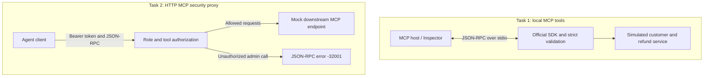
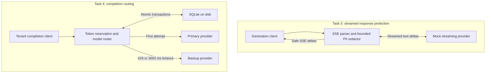
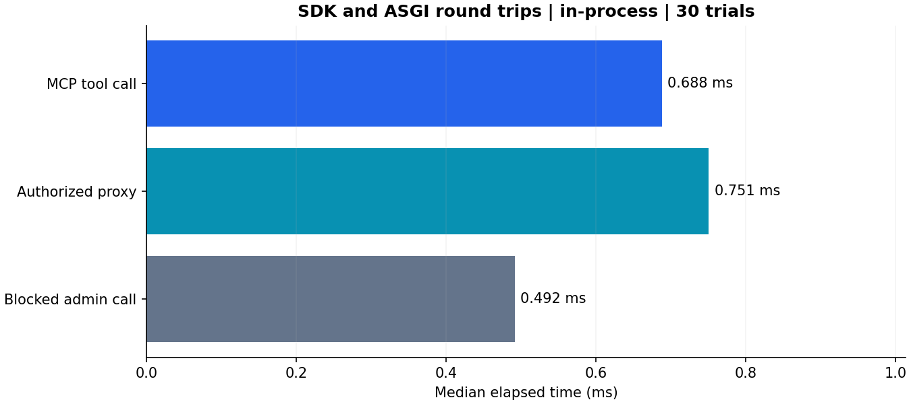
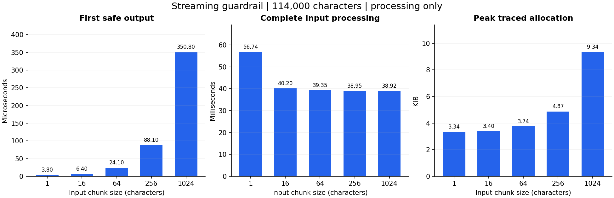
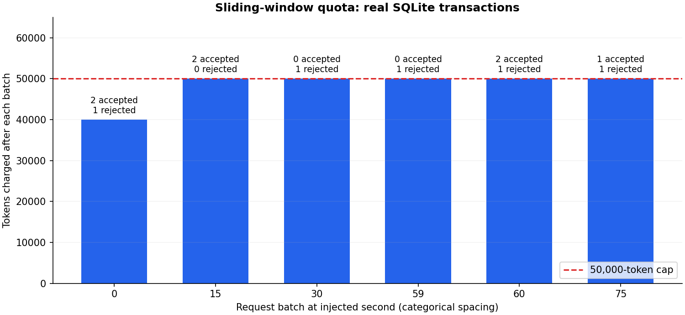
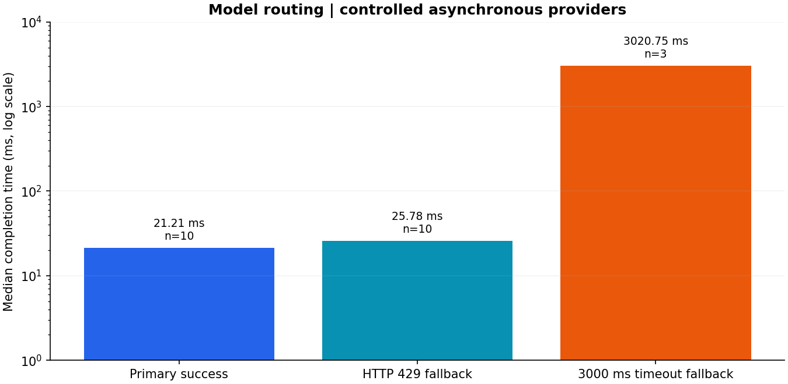

# Quilr AI Field Developer Assessment

[](https://github.com/vedhireanvesh29-eng/Quilr_ai_Assessment/actions/workflows/ci.yml)

A runnable Python assessment covering MCP tools, MCP authorization, streaming PII protection, and resilient LLM routing. All four tasks run locally with simulated customers, refunds, credentials, and providers. No paid LLM API key is required.

## Requirements review

The four-task assessment has been checked against its detailed implementation text. [REQUIREMENTS.md](REQUIREMENTS.md) maps each requirement to code and executable evidence, including the newly fixed PII prefix leak, malformed input cases, conservative usage reconciliation, late stale-event completion, and real stdio/TCP verification.

`scripts/verify_all.py` now starts and stops isolated real services; it is not a wrapper around pytest. `scripts/run_demo.py` checks startup and exits on a child failure. The launcher accepts `--host` and `--base-port`; the corresponding environment settings are `GATEWAY_HOST` and `GATEWAY_PORT`. Local-only mock clients avoid external proxy settings.

## Project overview

| Task | What it demonstrates | Main implementation |
|---|---|---|
| 1. Custom MCP server | Strict tool inputs, discovery, JSON-RPC errors, and isolated stdio | `task1_mcp_server/` |
| 2. MCP security gateway | Bearer roles, transparent discovery, and blocking `admin_` calls before forwarding | `task2_mcp_gateway/` |
| 3. Streaming PII guardrail | Incremental SSE parsing and redaction across arbitrary chunk boundaries | `task3_stream_guardrail/` |
| 4. Model router | SQLite sliding-window quotas, atomic reservations, and one bounded fallback | `task4_model_router/` |

The repository contains the source, deterministic mocks, unit and integration tests, a dependency lockfile, demo scripts, raw measurements, and PNG figures.

## System architecture

These are independent assessment services. The security proxy uses its own HTTP mock backend; it does not automatically connect to the stdio server.





Task 4 returns a single completion rather than restarting a partially delivered stream. Task 3 performs streaming independently.

## Technology stack

| Technology | Use |
|---|---|
| Python 3.11+ | Type hints, standard-library utilities, executable services |
| Official MCP Python SDK v2 | Tool registration, protocol lifecycle, framing, and invocation |
| Pydantic v2 | Strict tool and HTTP request validation |
| FastAPI / Uvicorn | HTTP endpoints and SSE response delivery |
| HTTPX / asyncio / AnyIO | Reusable asynchronous clients, cancellation, timeouts, transport adapters |
| SQLite | Persistent tenant quotas, reservations, reconciliation, WAL transactions |
| pytest / pytest-asyncio | Unit, ASGI integration, cancellation, concurrency, and real stdio tests |
| Ruff | Lint and formatting checks |
| Matplotlib | Measured performance figures; optional benchmark dependency |

Runtime and test dependencies are pinned in [uv.lock](uv.lock). Matplotlib is installed only by the report command, with version `3.10.7`.

## Test results and measurement dashboard

Snapshot from [the measurement run](https://github.com/vedhireanvesh29-eng/Quilr_ai_Assessment/actions/runs/41909973863), taken at **2026-11-04 20:47:59 UTC**, using application revision [b31491b](https://github.com/vedhireanvesh29-eng/Quilr_ai_Assessment/commit/b31491b6c7beca532a279ef9b216ec7dc58bf655). Counts come from the run's actual `results.xml`; measurements come from [docs/metrics.json](docs/metrics.json).

| Component | Passed | Failed | Skipped | Total | Measured result |
|---|---:|---:|---:|---:|---|
| MCP server | 3 | 0 | 0 | 3 | 0.229 ms median tool round trip |
| Security gateway | 7 | 0 | 0 | 7 | 0.479 ms allowed; 0.335 ms blocked |
| Streaming PII | 10 | 0 | 0 | 10 | 21.500 µs first safe output at 64-character chunks |
| Model router | 16 | 0 | 0 | 16 | 3.013 s completion after the 3 s timeout |
| Shared JSON-RPC validation | 1 | 0 | 0 | 1 | Malformed-envelope checks |
| **All collected tests** | **37** | **0** | **0** | **37** | **Executed with pytest** |

This dated baseline included inherited limiter checks under the router class. The requirements-review suite removes those five duplicates and adds independent regression and real-process tests. They are not a code-coverage percentage. Lint, formatting, and locked installation are separate CI checks.

The tests exercise:

- MCP initialization, discovery, successful tools, invalid arguments, unknown customers/tools, malformed JSON/envelopes, and clean protocol stdout.
- Viewer/admin authorization, transparent discovery, rejected-call backend counts, and sanitized downstream failures.
- Every split point, 100 seeded randomized chunk layouts, Unicode SSE, malformed events, bounded pending state, and upstream cleanup on cancellation.
- Tenant isolation, exact quota boundaries, expiry, independent SQLite connections, concurrent admission, primary success, timeout cancellation, fallback, and retained failure charges.

## Performance plots

All figures are generated by [scripts/benchmark_report.py](scripts/benchmark_report.py). The snapshot used Python **3.12.16** on Linux x86_64 with **4 logical CPUs**. Raw samples, repetitions, environment details, configured delays, and token batches are committed in [docs/metrics.json](docs/metrics.json).

These are small, single-runner measurements with controlled mocks. They measure implementation behavior; they do not establish production capacity or real LLM provider latency.

### MCP tool and authorization latency



Thirty trials per operation. The MCP measurement uses the official SDK client and server in one process. Proxy measurements use HTTPX ASGI and mock transports. The clock covers the complete in-process call, including validation and response handling; it excludes TCP, TLS, subprocess startup, and remote network time.

| Operation | Median | P95 | Trials | Backend calls |
|---|---:|---:|---:|---:|
| MCP customer tool | 0.229 ms | 0.342 ms | 30 | SDK tool invoked |
| Viewer, permitted tool | 0.479 ms | 0.728 ms | 30 | 30 |
| Viewer, blocked admin tool | 0.335 ms | 0.361 ms | 30 | **0** |

### Streaming latency and memory



The corpus contains 114,000 characters with repeated email and card values. Each chunk size has seven timed trials. First output means elapsed processing time until `feed()` returns its first nonempty safe string. It is **not network TTFT**.

For 64-character chunks, median complete-input processing took **36.316 ms**, first safe output took **21.500 µs**, and the separate memory pass measured **3.74 KiB** of peak traced allocation. The longest pending candidate in this corpus was **19 characters**, against the configured 4,096-character cap.

Memory is measured in a separate `tracemalloc` pass to keep tracing overhead out of the timing results. It excludes the preallocated corpus, interpreter baseline, and native process RSS. The memory plot is not a whole-process memory claim.

### Token-rate-limit behavior



This chart uses **real concurrent SQLite transactions** with an injected logical clock; the horizontal batches have categorical spacing. It does not wait 75 wall-clock seconds or simulate a model generating tokens.

At logical second zero, three independent connections request 20,000 tokens each. **Two are admitted and one is rejected**, leaving 40,000 tokens charged. Later batches fill the limit, demonstrate rejection at capacity, and exercise rolling expiration. All observed totals stay within the 50,000-token cap.

The JSON includes each request batch and measured SQLite transaction time. It does not label reservation throughput as LLM token-generation throughput. Admission order among unequal concurrent requests can vary.

### Model failover timing



| Scenario | Median completion | P95 | Trials |
|---|---:|---:|---:|
| Primary success | 14.253 ms | 122.962 ms | 10 |
| Primary HTTP 429, then backup | 32.748 ms | 140.539 ms | 10 |
| Primary exceeds 3000 ms, then backup | 3012.820 ms | 3191.797 ms | 3 |

The providers are asynchronous fixtures: successful primary work waits 10 ms, the 429 fixture waits 10 ms before raising, and the backup waits 5 ms. The timeout fixture waits 5 seconds but is cancelled by the router's actual **3,000 ms** deadline. Measurements include SQLite reservation, scheduling, provider waits, and reconciliation. The primary was cancelled in all three timeout trials before completion was returned.

## Installation and execution

Requires Python 3.11+ and [uv](https://docs.astral.sh/uv/).

```sh
git clone https://github.com/vedhireanvesh29-eng/Quilr_ai_Assessment.git
cd Quilr_ai_Assessment
uv sync --locked
uv run python scripts/run_demo.py
```

The launcher starts five localhost processes. Run the stdio MCP server separately with `uv run assessment-mcp`; it waits for protocol input and does not expose an HTTP port.

| Component | Command | Address |
|---|---|---|
| Task 1: MCP tools | `uv run assessment-mcp` | stdio |
| Task 2: security gateway | `uv run uvicorn ai_field_assessment.task2_mcp_gateway.app:app --port 8000` | `POST /mcp` |
| Mock downstream MCP | `uv run uvicorn ai_field_assessment.task2_mcp_gateway.mock_mcp_server:app --port 8001` | `POST /mcp` |
| Mock LLM providers | `uv run uvicorn ai_field_assessment.task3_stream_guardrail.mock_llm_provider:app --port 8002` | `/generate`, `/primary`, `/backup` |
| Task 3: streaming guardrail | `uv run uvicorn ai_field_assessment.task3_stream_guardrail.app:app --port 8003` | `POST /generate` |
| Task 4: model router | `uv run uvicorn ai_field_assessment.task4_model_router.app:app --port 8004` | `POST /completions` |

FastAPI documentation is available at `/docs` on each HTTP service. Bind to localhost for these development demonstrations.

## Implementation details

### Task 1: validated MCP tools

`get_customer_record` accepts `{"customer_id":"CUST-12345"}` and returns a simulated active customer. `trigger_refund` accepts:

```json
{"customer_id":"CUST-12345","amount":75.5,"reason":"Product arrived damaged"}
```

Its result includes a `mock-` refund ID, decimal amount string, and `"status":"simulated"`. Customer identifiers require exactly five ASCII digits. Fields are strict, unexpected arguments are refused, and refund amounts must be finite positive numbers. Boolean and string amounts are rejected.

The official MCP SDK v2 owns transport framing, lifecycle, discovery and tool registration. Public middleware maps argument validation to a top-level JSON-RPC `-32602`. Unknown customer business errors use SDK tool errors. See [DESIGN.md](DESIGN.md) for the distinction and version caveats.

Example JSON-RPC call:

```json
{"jsonrpc":"2.0","id":3,"method":"tools/call","params":{"name":"get_customer_record","arguments":{"customer_id":"CUST-12345"}}}
```

The tool's application data is:

```json
{"customer_id":"CUST-12345","name":"Demo Customer","status":"active"}
```

The SDK wraps application data in MCP tool content. A valid but unknown identifier returns an `isError:true` tool result with `Customer not found`; it is distinct from a malformed-argument JSON-RPC error.

Use MCP Inspector with Node.js installed:

```sh
npx @modelcontextprotocol/inspector uv run assessment-mcp
```

Connect with stdio, list the two tools, and call each with the examples above. No authentication is added to Task 1.

### Task 2: authorization proxy

```sh
curl -s http://127.0.0.1:8000/mcp -H 'Authorization: Bearer dev-viewer' -H 'Content-Type: application/json' -d '{"jsonrpc":"2.0","id":5,"method":"tools/call","params":{"name":"admin_reset_key","arguments":{}}}'
```

Expected response, without contacting the backend:

```json
{"jsonrpc":"2.0","id":5,"error":{"code":-32001,"message":"Unauthorized Tool Call"}}
```

Replace the token with `dev-admin` to permit the call. `tools/list` is forwarded transparently, including administrative tools. Roles come exclusively from configured tokens. This is mock authentication, not a production identity system.

The HTTP demonstration accepts one JSON-RPC request per POST. It deliberately rejects batches and notifications; it is not a complete stateful Streamable HTTP MCP implementation. URLs are configured by the server, and incoming headers are not copied to the backend.

### Task 3: streaming redaction

```sh
curl -N http://127.0.0.1:8003/generate -H 'Content-Type: application/json' -d '{"prompt":"Contact john@gmail.com, SSN 123-45-6789, card 4111 1111 1111 1111. Hello!"}'
```

The mock provider echoes the prompt as character deltas, splitting all PII. The gateway emits SSE `data: {"text":"..."}` events followed by `data: [DONE]`. Concatenating text deltas gives redacted output in order. SSE framing can differ from upstream because one safe output segment can span multiple input events.

For the example above, concatenated safe text is:

```text
Contact [REDACTED], SSN [REDACTED], card [REDACTED]. Hello!
```

The redactor buffers candidates until safe delimiters, retains numeric runs across spaces and hyphens, checks cards with Luhn, and replaces detected values with `[REDACTED]`. Oversized candidates fail closed. Errors terminate with a sanitized SSE error event and discard uncommitted text. Cancellation closes the upstream response.

### Task 4: quota and fallback

```sh
curl -s http://127.0.0.1:8004/completions -H 'X-API-Key: demo-tenant' -H 'Content-Type: application/json' -d '{"prompt":"[429] demonstrate fallback","max_output_tokens":64}'
```

Response fragment for this simulated fallback:

```json
{"text":"Simulated backup response","model":"backup"}
```

The complete response also reports `usage_tokens`. A prompt beginning `[timeout]` makes the mock primary exceed the default three-second timeout. `[error]` returns an upstream 500 and does not fall back. Other prompts use the primary.

Quota defaults to 50,000 tokens per tenant over a rolling 60 seconds. Before forwarding, an atomic SQLite transaction reserves UTF-8 input bytes plus maximum output tokens. The byte counter is conservative for the mock and byte-based tokenizers; replace the counter for a provider with different tokenization. Primary success reconciles to at least observed input/output under the configured counter. Fallback retains at least one full reservation and any larger observed or reported charge; unknown failures retain the reservation. Tenant keys are hashed before storage. Development tenant keys identify tenants without authenticating them.

```json
{"error":{"code":"RATE_LIMIT_EXCEEDED","message":"Unable to process this request","request_id":"generated-id"}}
```

Errors use HTTP 429 for quota, 422 for invalid input, 401 for missing tenant key, 502 for provider failure, 504 when fallback times out, and 503 for database failure.

## Design decisions

| Concern | Implemented decision | Consequence |
|---|---|---|
| Tool validation | Strict Pydantic schemas and public SDK middleware | Extra fields and invalid types receive top-level `-32602` |
| Malformed stdio input | Map exceptions from the SDK parser through a public transport adapter | `-32700` for invalid JSON; `-32600` for invalid envelopes |
| Business errors | Recognize typed customer exceptions and sanitize other tool failures | Unknown customers return a clear tool error without internal diagnostics |
| Authorization | Resolve roles from configured Bearer tokens, then check `admin_` names | Blocked calls never reach the backend; discovery stays transparent |
| Streaming boundaries | Retain a candidate across deltas and numeric runs across spaces/hyphens | Split PII is inspected before release |
| Oversized candidates | Emit one redaction marker and discard through a safe boundary | Bounded pending state; long safe identifiers can be over-redacted |
| Concurrency | `BEGIN IMMEDIATE` around quota check and insertion | Independent connections share one atomic admission decision |
| Token accounting | Reserve before forwarding; reconcile known primary usage | Fallback and failures retain one full logical-request charge |
| Failover | Cancel primary at its deadline, then attempt backup once | No late-primary response race or infinite retry loop |
| Resources | Lifespan HTTP clients, response contexts, threaded SQLite I/O | Connections are reused and cancellation releases upstream resources |

See [DESIGN.md](DESIGN.md) for protocol compatibility, stale reservations, error distinctions, token assumptions, and performance trade-offs. Development credentials and tenant identifiers are mock authentication.

## Configuration

`.env.example` documents defaults. Export variables in your shell or use Uvicorn's `--env-file .env` with the optional dotenv dependency. The application does not implicitly load `.env` files. CLI `--host` and `--port` control binding. All upstream defaults use localhost.

| Variable | Default |
|---|---|
| `GATEWAY_HOST`, `GATEWAY_PORT` | `127.0.0.1`, `8000` (demo host and base port) |
| `MCP_SERVER_NAME` | `Assessment Customers` |
| `DOWNSTREAM_MCP_URL` | `http://127.0.0.1:8001/mcp` |
| `ADMIN_TOKEN`, `VIEWER_TOKEN` | `dev-admin`, `dev-viewer` |
| `LLM_STREAM_URL` | `http://127.0.0.1:8002/generate` |
| `PRIMARY_PROVIDER_URL`, `BACKUP_PROVIDER_URL` | local mock `/primary`, `/backup` |
| `PRIMARY_TIMEOUT` | `3.0` seconds, also caps backup duration |
| `DATABASE_PATH` | `data/usage.db` |
| `TOKENS_PER_MINUTE` | `50000` |
| `PII_BUFFER_SIZE` | `4096` characters |
| `LOG_LEVEL` | `INFO` |

Real endpoints must implement the documented local contracts or use an adapter. No claim is made that these mock payloads are OpenAI- or Anthropic-compatible.

## Reproduce tests and figures

From the repository root:

```sh
uv sync --locked
uv run ruff check .
uv run ruff format --check .
uv run pytest -v --junitxml=results.xml
uv run --with matplotlib==3.10.7 python scripts/benchmark_report.py
```

The report command reads the just-generated JUnit XML, measures the implementation, and writes `docs/metrics.json` plus four PNGs under `docs/images/`. It intentionally takes roughly nine seconds just for the three real timeout trials, plus setup and other measurements. Timing is reported, not used as a flaky CI pass/fail threshold. GitHub Actions uploads the XML, metrics, images, and lockfile as verification artifacts.

The committed README dashboard is a dated snapshot. Regenerating the report updates the metrics and figures; update the dashboard values when publishing a new snapshot.

| Path | Contents |
|---|---|
| `src/ai_field_assessment/` | Four services, shared configuration, and validation |
| `tests/` | Unit and integration tests |
| `scripts/run_demo.py` | Launch the five localhost HTTP processes |
| `scripts/verify_all.py` | Live stdio/TCP verification with isolated services and automatic cleanup |
| `scripts/benchmark_report.py` | Generate task-level counts, measurements, and PNGs |
| `docs/metrics.json` | Raw measured samples and provenance |
| `docs/images/` | README performance figures |
| `DESIGN.md` | Detailed design decisions and limitations |
| `.github/workflows/ci.yml` | Locked installation, checks, tests, and report artifacts |

## Limits and next steps

PII detection follows explicit lexical rules, not every possible representation. Conservative candidate buffering can redact long safe tokens, delay a whitespace-free response, or hide incomplete email-like tokens. Retained pending state is bounded; request and HTTP transport buffers have their own limits. Production deployments also need provider-specific tokenization, trusted tenant identity, OIDC authentication, request size limits, TLS, telemetry, and a full MCP HTTP session implementation where applicable.

SQLite is suitable for a local assessment and a shared on-disk database on one host. It is not a cross-region quota service. A provider that suppresses task cancellation can delay timeout completion; adapters must honor cancellation. Refund IDs are simulated and refund records are returned rather than persisted.
